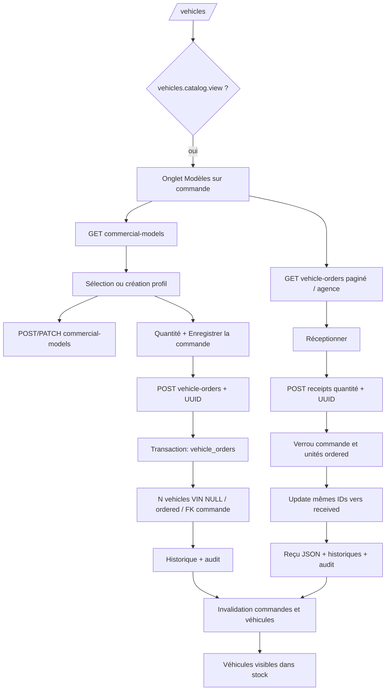

# Workflow réellement implémenté

Workflow secondaire : `/vehicles/catalog` → redirection `/vehicles` → vue « Véhicules en stock »; l'utilisateur doit cliquer l'onglet. Aucun workflow de détail/annulation de commande.

